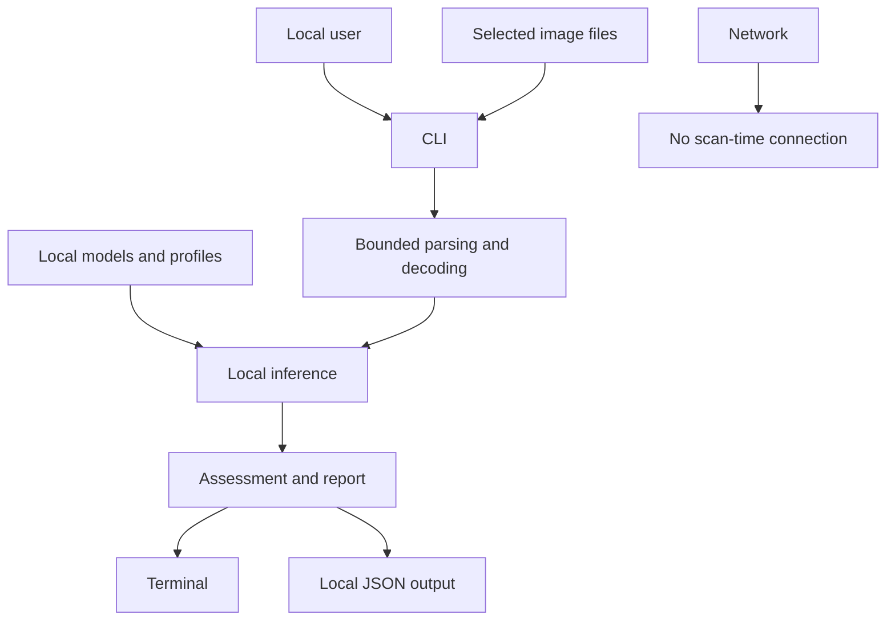

# Epics threat model

**Historical:** This threat model covers the superseded local image-scanner CLI. It does not
cover DocShield's API, sensitive document data, or new trust boundaries; threat modeling must
be revisited before DocShield implementation or any external exposure.

## Executive summary

The current repository is a requirements-and-planning repository, not an implemented scanner. The top runtime risks are hostile image/metadata causing parser resource exhaustion or code execution, accidental exposure of sensitive metadata in JSON, and unsupported inference/provenance code making network requests or overstating results. The PRD/SPEC require controls for these risks, but none is yet demonstrated by application code.

## Scope and assumptions

- **In scope:** Intended v1 runtime defined in `PRD.md`, `SPEC.md`, and `docs/architecture/architecture.md`; local input files, parser/decoder/model processing, terminal output, and optional JSON output.
- **Out of scope:** Remote services, hosted inference, multi-user processing, automatic consequential action, and attacker control of installed software or model artifacts.
- **Context confirmed by user:** Single local user manually selects files; files may be hostile; no remote service or shared processing. Installed software/model artifacts are operator-controlled.
- **Current state:** No runtime implementation, CI workflow, dependency manifest, or test suite exists. Requirements below are intended controls, not existing controls.
- **Open questions:** Exact decoder/parser/C2PA/model dependencies, OS sandbox availability, packaging/updates, and output-path concurrency behavior can change risk ranking.

## System model

### Primary components

- Local CLI and per-image orchestration (`docs/architecture/architecture.md`).
- Image decoder and metadata/provenance parser candidates (Pillow, ExifTool, C2PA SDK; `docs/product/research.md`).
- Local model/reference artifacts (not selected; `SPEC.md` REQ-11–REQ-12).
- Terminal output and optional JSON report (`SPEC.md` REQ-7, REQ-16, REQ-18–REQ-19).
- Build/test tooling is not selected or implemented and is excluded from runtime-flow claims.

### Data flows and trust boundaries

- User-selected filesystem path → CLI: path string over process arguments; validate count, type, and directory/URL rejection. No authentication is applicable to the single-user CLI (`SPEC.md` REQ-1).
- Local image bytes → decoder, metadata parser, provenance validator, and model inference: local file/memory and possible subprocess pipes; bytes and embedded fields are attacker-controlled. Required controls include byte/pixel/time/metadata bounds and per-file failure isolation (`SPEC.md` REQ-2, REQ-4, REQ-6).
- Local model/profile/trust-list artifacts → inference/provenance modules: operator-controlled local files; exact version and provenance must be reported. No scan-time fetch is allowed (`SPEC.md` REQ-3, REQ-8, REQ-12).
- Analysis result → terminal: process output; must avoid dumping sensitive metadata (`SPEC.md` REQ-7, REQ-16).
- Analysis result → selected JSON destination: local filesystem; may contain GPS, device identifiers, timestamps, and prompt fields. Must use safe atomic writes and refuse symlink/input destinations (`SPEC.md` REQ-7, REQ-19).
- Runtime → network: no intended channel. Offline behavior must be verified; C2PA revocation freshness must be disclosed (`SPEC.md` REQ-3, REQ-8).

#### Diagram

## Assets and security objectives

| Asset | Why it matters | Security objective (C/I/A) |
|---|---|---|
| Original images and digest | User evidence and identity of analyzed bytes | C: user-controlled; I: digest matches analyzed bytes; A: preserve originals |
| Parseable metadata and JSON report | May expose GPS, device, creator, timestamps, prompt data | C: private local handling; I: faithful extraction/labeling |
| Model, threshold, and reference profile | Determines interpretation and reproducibility | I: exact, versioned local artifacts; A: bounded inference |
| Parser/decoder/model runtime | Processes hostile bytes; failures can affect host availability | I: trusted installation; A: bounded processing |
| Verdict and advisory | May influence human investigation | I: evidence-bound, calibrated language; no false certainty |
| Output destination | May overwrite or expose user files | C/I: user-selected and protected from input collision; A: atomic write |

## Attacker model

### Capabilities

- A source can provide a crafted image or metadata block that the user manually selects.
- Embedded metadata can be malformed, false, oversized, or designed to mislead.
- A local process may race or alter files if input handling reopens paths instead of operating on stable bytes.

### Non-capabilities

- No remote request path or public service is in scope.
- Attacker does not control the user's installed executable, dependencies, model artifacts, or local filesystem account.
- No multi-tenant or cross-user access is expected.

## Entry points and attack surfaces

| Surface | How reached | Trust boundary | Notes | Evidence |
|---|---|---|---|---|
| CLI path arguments | User selects 1–5 paths | User → process | Reject dirs/URLs and invalid count | `SPEC.md` REQ-1 |
| Image decoder | Selected JPEG/PNG | File → decoder | Malformed payloads, decompression/resource exhaustion | `SPEC.md` REQ-2, REQ-4, REQ-9 |
| Metadata/provenance parser | Embedded EXIF/XMP/IPTC/ICC/C2PA | File bytes → parser/subprocess | Nested/oversized blocks; false claims; parser vulnerabilities | `SPEC.md` REQ-6–REQ-8 |
| Model/profile loader | Local configured files | Operator artifacts → inference | Integrity/version mismatch; unsafe artifact format | `SPEC.md` REQ-11–REQ-12; `docs/product/research.md` |
| Terminal renderer | Findings and metadata | Internal result → user terminal | Sensitive values/control characters | `SPEC.md` REQ-7, REQ-16 |
| JSON writer | User-selected output path | Process → local filesystem | Sensitive output, symlink/input overwrite, partial writes | `SPEC.md` REQ-18–REQ-19 |
| Network-capable libraries | Parser/provenance/inference code paths | Process → network | Unexpected revocation/model/telemetry connections violate offline promise | `SPEC.md` REQ-3, REQ-8 |

## Top abuse paths

1. **Availability via crafted image:** attacker supplies malformed/high-expansion image → user scans it → decoder consumes excessive memory/time or crashes → scan/host availability suffers.
2. **Availability or code execution via metadata:** attacker embeds adversarial nested metadata → parser processes it without effective bounds → parser hangs/crashes or a parser flaw executes code with the user's privileges.
3. **Sensitive data exposure:** user requests JSON in a shared or synced location → report includes GPS/device/prompt metadata → unintended reader obtains sensitive details.
4. **Input/report integrity loss:** output destination aliases an input or changes to a symlink during write → report write overwrites evidence or escapes intended destination.
5. **Network/privacy violation:** a parser or validator attempts online revocation, telemetry, or model retrieval → image-derived data or metadata may leave the machine, violating offline behavior.
6. **Misleading assessment:** unsupported model/profile or forged metadata is treated as definitive → report implies authenticity or overstates detector confidence → reviewer makes an unsound decision.

## Threat model table

| Threat ID | Threat source | Prerequisites | Threat action | Impact | Impacted assets | Existing controls (evidence) | Gaps | Recommended mitigations | Detection ideas | Likelihood | Impact severity | Priority |
|---|---|---|---|---|---|---|---|---|---|---|---|---|
| TM-001 | Malicious file provider | User scans a crafted image | Trigger decoder resource exhaustion or exploit a decoder flaw | Scan failure or code execution as local user | Runtime, host availability, image data | Required byte/pixel limits and decoder safeguards (`SPEC.md` REQ-4) | No implementation or runtime evidence | Enforce pre-decode limits, keep decoder patched, process sequentially, test adversarial fixtures; consider OS resource sandbox if feasible | Timeout/limit failure status; security regression corpus | Medium | High | medium |
| TM-002 | Malicious file provider | Crafted metadata reaches parser | Exhaust parser time/memory or exploit parser | Denial of service or local code execution | Runtime, host availability, user files | Required metadata/time bounds and per-file isolation (`SPEC.md` REQ-4, REQ-6) | Bounds and subprocess isolation not implemented; subprocess is not sandbox | Fixed parser invocation, no shell, strict timeout/output caps, patched dependency, sandbox if available, malformed/nested fixtures | Record parser version, error, timeout and resource-limit outcome | Medium | High | medium |
| TM-003 | Accidental recipient / local malware | JSON report is written to accessible or synced path | Read sensitive metadata included by default | Privacy loss, location/device exposure | Metadata and report | Terminal redaction required; JSON sensitivity documented (`SPEC.md` REQ-7) | Destination privacy is user-chosen; no permissions policy yet | Warn on sensitive JSON; restrictive file permissions; avoid default output path; document storage/sync risk | Report creation audit in CLI summary without metadata values | Medium | Medium | medium |
| TM-004 | Path manipulation / concurrent local process | Output path aliases input or changes during write | Bypass naive path check or exploit non-atomic write | Evidence overwrite or unintended file replacement | Original image, report, filesystem | Atomic write and symlink/input refusal required (`SPEC.md` REQ-19) | No code; race-resistant path handling unspecified | Use directory-relative safe creation/replace, compare resolved identities, keep temp in destination directory, test symlinks/hard links/races | Explicit refusal/error status; tests for alias and race cases | Low | High | low |
| TM-005 | Library behavior or configuration error | Scan invokes a network-capable dependency path | Fetch remote revocation/model data or send telemetry | Privacy breach and offline-contract violation | Image/metadata, privacy, reproducibility | Offline requirement and revocation disclosure (`SPEC.md` REQ-3, REQ-8) | Research has not established C2PA SDK network behavior (`docs/product/research.md` §Offline C2PA validation) | Deny egress in integration tests; local trust/profile files; no runtime fetch; verify OS-level network isolation option | Fail test on any outbound attempt; record offline validation state | Low | High | medium |
| TM-006 | Misleading embedded claims or unsupported model profile | User relies on output beyond validated domain | Treat absent/false metadata or unvalidated score as proof | Unsound human decision | Verdict integrity and reviewer trust | SPEC requires calibrated semantics, inconclusive states, and no authenticity/fraud judgment (`SPEC.md` REQ-8, REQ-11–REQ-17) | No selected/evaluated models or profile; results not yet supported | Enforce profile release gates in assessment logic; label raw/experimental scores; explain evidence coverage and limits | Tests over all task/verdict combinations; evaluation report and sample counts | Medium | Medium | medium |

## Criticality calibration

- **Critical:** Remote compromise or broad exposure of user data. Examples: none expected in v1 because no remote service or multi-user data store exists.
- **High:** Local code execution or loss/exposure of valuable user evidence. Examples: exploitable decoder/parser; JSON metadata disclosed outside the user's intended audience; report overwrites an original.
- **Medium:** Bounded scan failure, misleading evidence interpretation, or attempted network activity without demonstrated data exfiltration. Examples: parser timeout; out-of-domain detector result incorrectly shown as normal; forbidden revocation lookup.
- **Low:** Easily recoverable behavior with no data exposure or integrity loss. Examples: unsupported format rejected clearly; optional parser reports an explicit coverage error.

## Focus paths for security review

| Path | Why it matters | Related Threat IDs |
|---|---|---|
| `SPEC.md` | Normative input, privacy, verdict, network, and output-safety contract | TM-001–TM-006 |
| `PRD.md` | Product privacy and usage boundaries; JSON contains sensitive fields by default | TM-003, TM-005, TM-006 |
| `docs/architecture/architecture.md` | Intended parsing, model, output, and test seams; currently design-only | TM-001–TM-006 |
| `docs/product/research.md` | Candidate dependencies and known gaps, especially C2PA networking and parser bounds | TM-001, TM-002, TM-005 |
| `docs/product/acceptance-criteria.md` | Required security regression and release checks | TM-001–TM-006 |

## Notes on use

- Runtime protections above are specifications/recommendations, not evidence of implemented controls.
- Covered all currently specified entry points and trust flows; build/CI is excluded because none is configured.
- User confirmed single-user, manual local operation, hostile inputs possible, and operator-controlled installed/model artifacts.
- Reassess after implementation and dependency selection, especially parser sandboxing, filesystem race safety, and actual network behavior.
